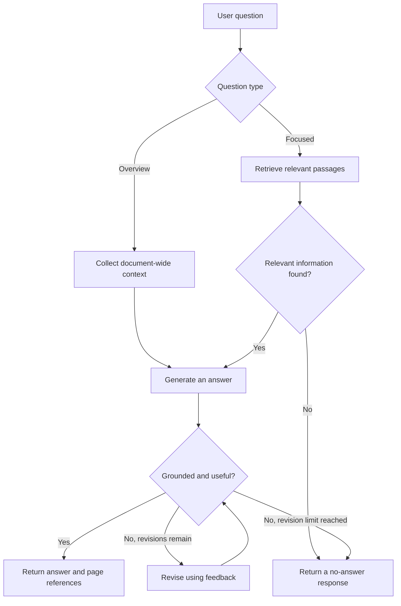

# Self-RAG PDF Assistant

A web application for asking questions about PDF documents. Upload a PDF, ask a question in natural language, and receive an answer grounded in the document with page references and supporting excerpts.

The application combines a **FastAPI** backend, a **LangGraph** retrieval and review workflow, **FAISS** vector search, and a responsive frontend built with **HTML, CSS, and JavaScript**.

> This project is a practical implementation of a retrieval-and-review workflow inspired by Self-RAG. It is not a reproduction of the original Self-RAG research model or its training procedure.

## Features

- Upload text-based PDFs through a file picker or drag and drop.
- View background indexing progress and document status.
- Ask questions, request summaries, explore takeaways, or get simple explanations.
- Use document-wide context for overview questions and semantic search for focused questions.
- Generate answers using the supplied PDF content.
- Review answers for grounding, citations, and relevance to the question.
- Revise an answer up to twice using review feedback.
- Display page citations, retrieved excerpts, and the workflow's review steps.
- Handle missing API credentials, invalid uploads, provider failures, and unsupported questions.
- Access interactive API documentation provided by FastAPI.
- Run without a frontend build step or Node.js installation.

## Technology stack

| Component | Technology |
| --- | --- |
| Backend API | FastAPI |
| Application server | Uvicorn |
| Workflow orchestration | LangGraph |
| Language-model integration | LangChain and `langchain-openai` |
| Chat model | Configurable OpenAI or OpenAI-compatible chat service |
| Embeddings | Google Generative AI through `langchain-google-genai` |
| Vector search | FAISS |
| PDF text extraction | PyPDFLoader / pypdf |
| Text splitting | RecursiveCharacterTextSplitter |
| Frontend | HTML, CSS, vanilla JavaScript |
| Configuration | Environment variables and python-dotenv |
| Tests | pytest and FastAPI TestClient / HTTPX |

## How it works

### Document indexing

1. The browser uploads a PDF to the backend.
2. The backend validates the file and starts an indexing task.
3. PyPDFLoader extracts text and page metadata.
4. The text is divided into overlapping passages.
5. Google embeddings convert the passages into vectors.
6. FAISS stores the vectors in memory for retrieval.
7. The document becomes available for questions.

### Question answering



For an overview, the application supplies all indexed passages when they fit its context budget. For larger documents, it selects passages across the PDF and explicitly discloses the limited coverage.

For focused questions, it searches using the original question and, when available, a meaning-preserving rewrite. It uses maximum marginal relevance (MMR) to select useful, less repetitive passages and removes duplicates.

The model can summarize and paraphrase the document. A review checks whether the answer addresses the question and is supported by the supplied context. Page references are also checked against the available passages. Model review is a quality check, not a guarantee of correctness.

## Recent improvements

The document question-answering workflow was updated to better support broad questions such as **“What is this PDF all about?”**, the frontend's suggested questions, and natural paraphrases.

| Area | Previous behavior | Current behavior |
| --- | --- | --- |
| Document overviews | Retrieved four similar passages for every question | Routes overview questions to document-wide context; uses all passages when they fit and discloses sampling for larger PDFs |
| Focused questions | Searched using only the original wording | Searches the original question and a meaning-preserving rewrite, using diverse retrieval and removing duplicates |
| Relevance checks | Applied the same relevance gate to broad and specific questions | Treats readable PDF content as relevant to an overview of that PDF; checks focused questions separately |
| Answer review | Separate support and usefulness votes, including a vote without PDF context | One review checks grounding and question coverage with access to the PDF context |
| Revisions | Revised without the specific reason for rejection | Supplies actionable reviewer feedback for up to two revisions |
| Review formatting | Required an exact `true` response | Accepts structured JSON and ordinary boolean capitalization and punctuation |
| Citations | Relied on generated source labels | Normalizes citations to PDF page references and validates those pages, including grouped references and ranges |
| Frontend feedback | Displayed answers and retrieved excerpts | Also labels overview answers and explains when document coverage is sampled |

Summaries, paraphrases, and synthesis across passages are accepted when grounded in the PDF. Questions about information absent from the document still receive a no-answer response.

After updating an existing installation, **restart the backend, refresh the browser, and re-upload the PDF** so the in-memory workflow is rebuilt. These changes require no new dependencies or API credentials.

### Verification

As of **6 October 2026**, **53 automated tests passed**, along with Python compilation and frontend JavaScript syntax checks. Live checks against a 12-page PDF also passed for:

- “What is this PDF all about?”
- All three frontend example questions: summary, takeaways, and a simple explanation.
- A focused question phrased differently from the document's terminology.
- An unrelated question, which correctly produced a no-answer response.

The overview checks used all 12 indexed passages and required no answer revisions. These are recorded checks on the tested configuration, not a guarantee for every PDF or provider.

## Project structure

```text
self-rag-web/
├── app.py                     # FastAPI routes, uploads, document state
├── self_rag.py                # PDF indexing and LangGraph workflow
├── static/
│   ├── index.html             # Application page
│   ├── styles.css             # Responsive styling
│   └── app.js                 # Upload, polling, questions, result rendering
├── tests/
│   ├── test_app.py            # API behavior and upload validation tests
│   └── test_workflow.py       # Retrieval, review, and citation tests
├── .env.example               # Configuration template; safe to commit
├── .gitignore
├── requirements.txt           # Application dependencies
├── requirements-dev.txt       # Application and test dependencies
├── requirements-lock.txt      # Frozen dependency snapshot
└── README.md
```

The `.env`, `.venv/`, and temporary `.data/` directory are local files and should remain outside version control.

## Prerequisites

- Python **3.11 or 3.12**. The project has been tested with Python 3.12.
- Git, if cloning the repository.
- A credential for the configured OpenAI-compatible chat service.
- A Google API key with access to the configured embedding model.
- An internet connection for model and embedding requests.

Model availability and usage limits depend on your provider account. Choose model names that your account can access.

## Installation

### 1. Clone the repository

Replace `YOUR_USERNAME` and `YOUR_REPOSITORY` with the repository's actual values:

```bash
git clone https://github.com/YOUR_USERNAME/YOUR_REPOSITORY.git
cd YOUR_REPOSITORY
```

Run the following commands from the directory containing `app.py` and `requirements.txt`.

### 2. Create an isolated Python environment

**Windows PowerShell**

```powershell
py -3.12 -m venv .venv
.\.venv\Scripts\python.exe -m pip install -r requirements.txt
```

If your default Python is already a supported version, you can use `python -m venv .venv` instead. Environment activation is optional because these commands call its interpreter directly.

**macOS / Linux**

```bash
python3.12 -m venv .venv
.venv/bin/python -m pip install -r requirements.txt
```

Use `python3` instead of `python3.12` if it already points to a supported Python version.

### 3. Configure credentials

Create `.env` from the example file.

**Windows PowerShell**

```powershell
Copy-Item .env.example .env
```

**macOS / Linux**

```bash
cp .env.example .env
```

Do this once during initial setup; do not overwrite an existing configured `.env`. Edit the new file:

```dotenv
OPENAI_API_KEY=your_chat_service_api_key
GEMINI_API_KEY=your_google_api_key

# Leave empty when using the default OpenAI endpoint.
OPENAI_ENDPOINT=
OPENAI_MODEL=gpt-4.1-mini

EMBEDDING_MODEL=gemini-embedding-2
EMBEDDING_DIMENSIONS=1536
EMBEDDING_BATCH_SIZE=90
EMBEDDING_BATCH_PAUSE_SECONDS=60
```

These are the application's configured defaults. Change the model names or endpoint if your provider requires different values. Keep actual keys in `.env` or your server's environment; never add them to the frontend or commit them to Git.

### 4. Start the application

**Windows PowerShell**

```powershell
.\.venv\Scripts\python.exe -m uvicorn app:app --host 127.0.0.1 --port 8000
```

**macOS / Linux**

```bash
.venv/bin/python -m uvicorn app:app --host 127.0.0.1 --port 8000
```

Open:

- [Web application](http://127.0.0.1:8000)
- [Interactive API documentation](http://127.0.0.1:8000/docs)
- [Health endpoint](http://127.0.0.1:8000/api/health)

For development, append `--reload` to the server command. Reloads restart the process and discard indexed documents, so upload the PDF again after a restart.

## Usage

1. Open the web application.
2. Choose or drop a text-based PDF.
3. Wait until its status is ready.
4. Enter a question or select one of the suggested questions.
5. Read the answer and inspect its page references and source excerpts.
6. Expand the review details to see the completed workflow steps.

Example questions:

- “What is this PDF about?”
- “What are the most important takeaways?”
- “Explain the main concept in simple terms.”
- “How does the process described in the document work?”
- “Summarize the information on page 3.”

Press **Enter** to send a question or **Shift + Enter** to insert a new line. Clear the conversation to remove displayed messages, or remove the active document to upload a different one.

Each question is processed independently. Earlier messages are displayed in the conversation but are not sent to the model as conversation history.

## Configuration

| Variable | Required | Default | Purpose |
| --- | --- | --- | --- |
| `OPENAI_API_KEY` | Yes | None | Credential for the configured chat service |
| `GEMINI_API_KEY` | Yes | None | Credential for Google embeddings |
| `OPENAI_ENDPOINT` | No | SDK's default endpoint | Custom OpenAI-compatible base URL |
| `OPENAI_MODEL` | No | `gpt-4.1-mini` | Chat model name |
| `EMBEDDING_MODEL` | No | `gemini-embedding-2` | Google embedding model name |
| `EMBEDDING_DIMENSIONS` | No | `1536` | Requested embedding dimensions |
| `EMBEDDING_BATCH_SIZE` | No | `90` | Passages per embedding batch, clamped to 1–90 |
| `EMBEDDING_BATCH_PAUSE_SECONDS` | No | `60` | Delay between embedding batches |

The batch delay helps pace requests; it does not guarantee compliance with every provider quota. Restart the backend after changing configuration.

## API reference

| Method | Endpoint | Description |
| --- | --- | --- |
| `GET` | `/api/health` | Reports service status and missing configuration names; does not return key values |
| `POST` | `/api/documents` | Accepts a PDF in multipart field `file` and returns a document ID with HTTP 202 |
| `GET` | `/api/documents/{document_id}` | Returns document status, progress message, page count, and chunk count |
| `POST` | `/api/ask` | Answers a question about a ready document |
| `DELETE` | `/api/documents/{document_id}` | Removes an idle document from the process's memory |

### Upload and status

Use **POST `/api/documents`** in the interactive API documentation to select a PDF. Copy the returned `id` and poll **GET `/api/documents/{document_id}`** until its `status` becomes `ready`.

Possible document statuses are `processing`, `ready`, and `error`. Upload acceptance does not mean indexing has completed.

### Ask a question

Send this JSON body to **POST `/api/ask`**:

```json
{
  "document_id": "ID_RETURNED_BY_UPLOAD",
  "question": "What is this document about?"
}
```

The response includes:

| Field | Meaning |
| --- | --- |
| `answer` | Generated answer or a no-answer message |
| `supported` | Whether the answer passed the application's checks |
| `sources` | Retrieved passages with filename, page number, excerpt, and ID |
| `steps` | Workflow steps performed |
| `revisions` | Number of revisions performed |
| `mode` | `overview` or `focused` |
| `context_note` | Coverage note when an overview uses limited excerpts |
| `elapsed_seconds` | Time spent answering the request |

### Common error responses

| Status | Typical reason |
| --- | --- |
| `400` | Empty uploaded file |
| `404` | Unknown document ID, including after a server restart |
| `409` | Document is busy, not ready, or the document limit was reached |
| `413` | Upload exceeds the file-size limit |
| `415` | Upload is not an accepted PDF file |
| `422` | Request fields fail validation |
| `502` | The AI service could not complete a question |
| `503` | Required API credentials are missing |

PDF parsing and embedding failures happen during background indexing and appear as document status `error` with a progress message.

## Tests

Install the development dependencies and run the test suite.

**Windows PowerShell**

```powershell
.\.venv\Scripts\python.exe -m pip install -r requirements-dev.txt
.\.venv\Scripts\python.exe -m pytest -q
```

**macOS / Linux**

```bash
.venv/bin/python -m pip install -r requirements-dev.txt
.venv/bin/python -m pytest -q
```

The automated tests use provider substitutes and do not make paid model calls. They cover API validation, upload limits, document lifecycle, retrieval choices, overview coverage, review parsing, citation handling, revision feedback, and no-answer behavior.

`requirements-lock.txt` contains a frozen dependency snapshot, including test dependencies. To reproduce that snapshot, install it instead of `requirements.txt`, using a compatible Python version and platform.

## Limits and data handling

| Setting | Current value |
| --- | --- |
| Maximum PDF upload | 20 MB (20 × 1024 × 1024 bytes) |
| Maximum indexed chunks per PDF | 2,000 |
| Maximum documents per server process | 8 |
| Maximum question length | 4,000 characters |
| Text chunk size | 2,500 characters |
| Text chunk overlap | 400 characters |
| Overview context budget | Approximately 60,000 characters, including allowance for passage labels |
| Maximum answer revisions | 2 |

- **Text-based PDFs only:** OCR is not included. Scanned pages may require OCR before upload.
- **Temporary storage:** Uploaded PDFs are removed after indexing finishes or fails. FAISS indexes and document state remain in memory until removal or server shutdown.
- **External model requests:** PDF passages are sent to the configured Google embedding service. Questions and selected document context are sent to the configured chat service.
- **No durable sessions:** The browser remembers the active document ID for the current tab, but documents and conversation history are not persisted as an application database.
- **Local, single-user design:** Run a single server worker. Authentication, durable job queues, and shared persistent storage are not implemented.
- **Review the sources:** Answers and automated reviews can be incorrect or incomplete.

## Troubleshooting

| Problem | What to check |
| --- | --- |
| “Setup required” appears | Add the required keys to `.env` beside `app.py`, restart the backend, and refresh the page. |
| Indexing fails | Check PDF validity, readable text, API keys, model access, network connection, and embedding quota. |
| Indexing pauses between batches | The default delay is 60 seconds when additional batches remain. |
| A scanned PDF has no readable text | Run OCR first or use a PDF with an extractable text layer. |
| A document is missing after restart | Upload it again; indexes are stored in memory. |
| The AI request fails | Check the configured endpoint, model name, credentials, provider quota, and connection. |
| The document limit is reached | Remove an idle document through the API, or restart the server to clear all in-memory documents. |
| FAISS cannot be installed | Check that the selected Python version and platform have a compatible `faiss-cpu` distribution. |
| Port 8000 is already in use | Start Uvicorn with another port, such as `--port 8001`, and open that port in your browser. |

## Contributing

Contributions are welcome. Keep changes focused, describe the behavior being changed, and run the tests before opening a pull request. Include relevant regression tests for changes to retrieval, review behavior, or API validation.

Do not commit API credentials, uploaded documents, virtual environments, local indexes, or private test data. Keep `.env.example` populated with placeholders only.

## License

No license is currently included in this project. Add a `LICENSE` file if you want to grant reuse permissions under a chosen license.
